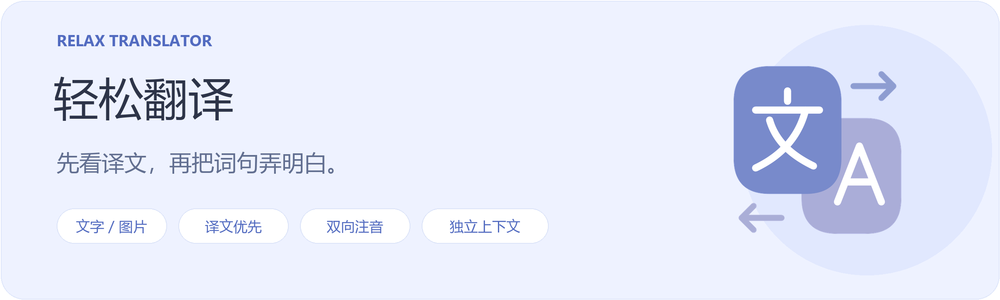
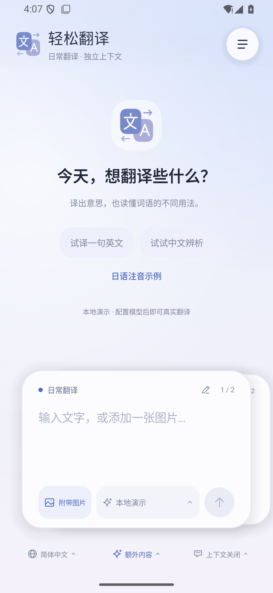
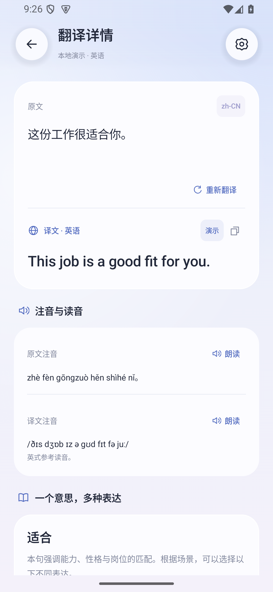
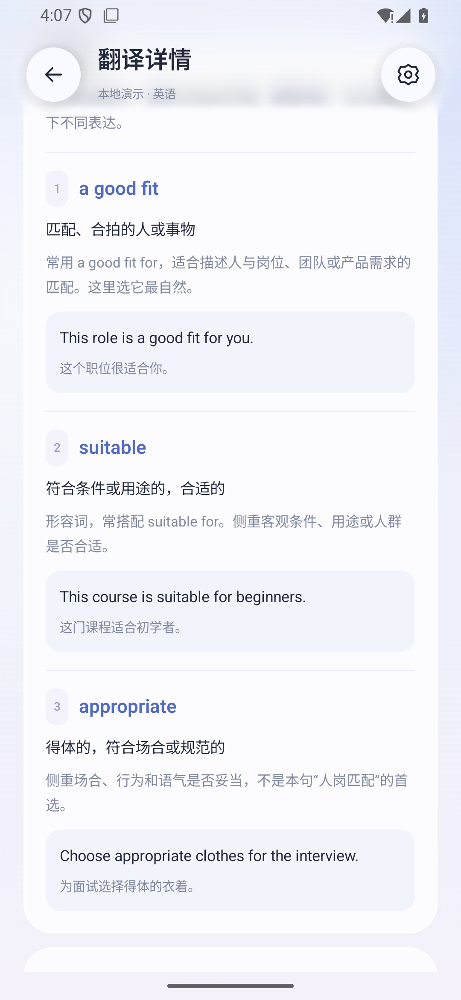
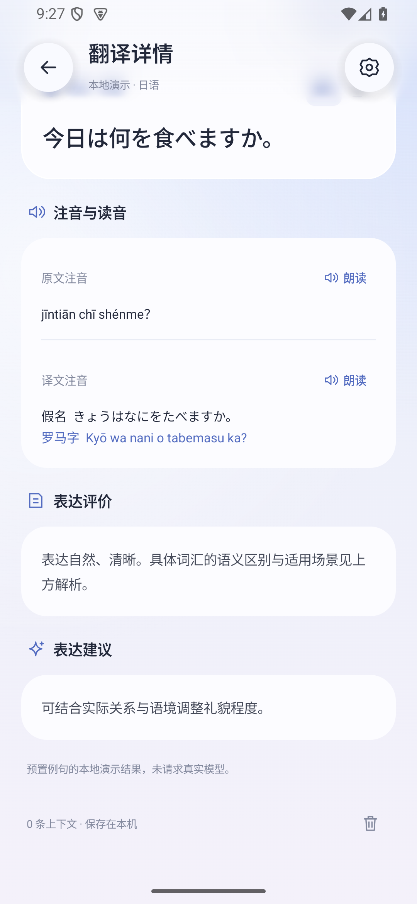
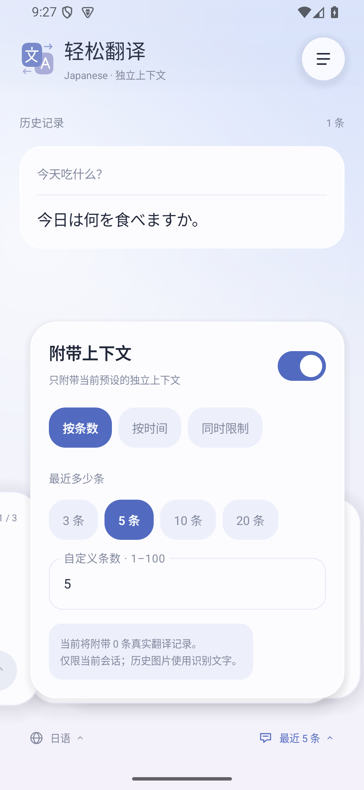
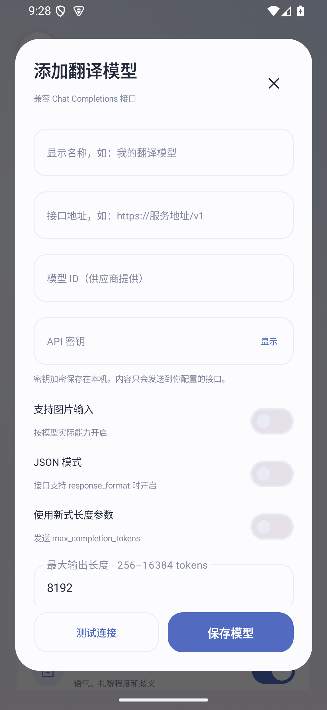

<div align="center">



**轻松翻译：由AI大语言模型（LLM）驱动的翻译安卓APP**

自选大模型，按语境翻译；工作、旅行、学习，各有自己的预设和上下文。


[**下载 APK**](https://github.com/dhc316/relax-translator/releases/latest) · [界面预览](#界面预览) · [使用说明](docs/使用说明.md) · [构建与验证](docs/开发与验证.md)

</div>

> 可以先用内置演示体验界面。翻译任意内容时，需要添加自己的模型接口与 API 密钥。

## 翻完，也弄明白

“适合”可以是 *suitable*，也可以是 *a good fit* 或 *appropriate*。轻松翻译会结合句子与上下文给出译文，再把不同说法、适用场景和用法展开讲清楚。

| 你想做的事 | 轻松翻译提供什么 |
| --- | --- |
| 迅速得到翻译结果 | 译文与完整解析并行请求，先得到的译文立即显示，解析随后补齐 |
| 翻译截图或照片 | 从图库选图，可补充文字说明，再交给支持图片的模型处理 |
| 知道怎么读 | 原文和译文分别提供注音与系统朗读；日语同时显示假名、罗马字 |
| 学会怎么用 | 查看词义辨析、常见搭配、例句、语气评价和替代表达 |
| 接着前面的内容翻 | 为当前预设开启上下文，按最近条数、时间或两者共同限制 |
| 在几个场景间切换 | 左右滑动卡片切换预设；模型、语言和偏好自动保存，历史与草稿各自独立 |
| 使用自己喜欢的模型 | 自定义兼容 Chat Completions 的接口、模型与密钥，按能力启用图片输入 |

译文和可编辑原文排在详情页最上方，注音紧接其后。模型判断原文确实有错时，才出现纠错解析。

## 界面预览

以下均为当前版本在 Android 上的实际运行截图。

<table>
  <tr><th>随手开始翻译</th><th>原文与译文，一眼看到</th><th>把词义和用法讲清楚</th></tr>
  <tr>
    <td></td>
    <td></td>
    <td></td>
  </tr>
  <tr><th>日语假名与罗马字</th><th>上下文，自己决定</th><th>模型，按需配置</th></tr>
  <tr>
    <td></td>
    <td></td>
    <td></td>
  </tr>
</table>

浅色背景、柔和卡片与渐变模糊，让内容保持清晰。输入区域会避让键盘，历史卡片只显示原文和译文，点开再看完整解析。

## 开始使用

1. 从 [Releases](https://github.com/dhc316/relax-translator/releases/latest) 下载 APK，安装到 Android 8.0 或更新版本的设备。
2. 打开首页示例，先体验翻译详情、词汇辨析和日语注音。
3. 进入 **菜单 → 设置 → 添加翻译模型**，填写接口地址、模型 ID 与密钥，选择目标语言后即可真实翻译。

图片输入需要模型支持视觉能力；朗读需要系统提供对应语言的语音服务。完整设置方法见 [使用说明](docs/使用说明.md)。

## 数据和请求

预设、草稿和翻译历史保存在手机上，API 密钥使用 Android Keystore 加密。发起真实翻译时，本次文字或图片以及你开启的上下文会发送到所选模型接口；关闭上下文后只发送本次输入。

每次翻译并行发送两个请求：A 只取译文，B 获取译文与完整解析。最终只保存一条历史；B 失败时仍保留 A 已返回的译文。接口用量按实际请求计算。

内置示例是本地演示，不调用远程模型；任意内容的真实翻译与解析由你配置的模型完成。

## 本地构建

使用 Android Studio 打开 `android/`，配置 JDK 17 或更高版本、Android SDK 35，即可运行调试构建。

Windows PowerShell 7 用户也可以在安装 Python 与 JDK 后运行：

```powershell
./tools/setup-sdk.ps1
./build.ps1
```

构建工具下载到项目内的 `.local/`。正式签名密钥、模型配置、原始个人参考图和本地缓存不进入仓库。应用沿用原包标识与签名以支持旧版覆盖升级。

| 目录 | 内容 |
| --- | --- |
| `android/` | Kotlin 与 Jetpack Compose 应用、核心及 Android 测试 |
| `docs/` | 使用说明、开发记录、品牌资源和实际截图 |
| `tools/` | 环境准备、品牌资源生成、构建检查与安装验证脚本 |
| `artifacts/` | 当前版本安装包及验证摘要 |

## 版本与验证

当前版本 **0.6.0**：统一更名为「轻松翻译」，更新雾蓝淡紫的翻译图标与轻量标题字体，移除设置页右上角的主题标签，并重新整理产品说明与截图。

58 项核心测试、22 项 Android 流程与渲染测试通过，Android 11、15 已完成正式包覆盖升级验证。检查结果见 [验证摘要](artifacts/v0.6.0/verification.json)，本次变化见 [0.6 更新说明](docs/0.6更新说明.md)。
